# Olist E-Commerce Sales Performance

## Project Overview

This project analyzes historical data from the Brazilian Olist e-commerce marketplace to understand business performance and identify useful trends.

The dataset is anonymized and covers activity from `2016` to `2018`. The analysis uses Python, Pandas, Matplotlib, and Seaborn.

## Data Cleaning & Preparation

Date fields in the orders, order items, and reviews data were converted to a date format for analysis.

Some information was missing. Most missing order dates matched the order’s status, such as canceled or not yet delivered. A few orders marked as delivered were also missing dates. Review comments and some product details were blank. These values were left blank rather than guessed, and no rows were removed because of missing information.

We checked all nine datasets for identical rows. Only the location data contained exact repeats: 261,831 rows were removed, reducing the table from 1,000,163 rows to 738,332. Different locations with the same postal-code prefix were kept. The original CSV files were not changed.

## Sales Performance — Current Findings

### Order Volume

The orders dataset contains **`99,441`** order records.

### Delivered Product Sales

The total value of product prices for delivered orders is **`R$ 13,221,498.11`**.

This measure sums item prices and excludes freight. It represents the product value associated with delivered orders, not profit or net accounting revenue.

### Monthly Trends

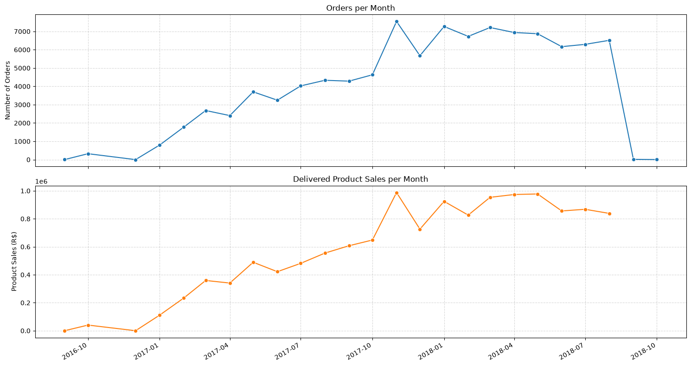

The monthly charts show that order volume and delivered product sales generally increased from late `2016` through `2017`, then fluctuated during `2018` rather than rising steadily.

The final months should be interpreted cautiously because they may be incomplete. In addition, sales are counted only for delivered orders, so recent purchases may not yet appear in delivered product sales.

### Highest and Lowest Sales Months

Delivered product sales peaked in **November `2017`**, reaching **`R$ 987,765.37`**. The next-highest months were **May `2018`** (**`R$ 977,544.69`**) and **April `2018`** (**`R$ 973,534.09`**).

Among months with recorded delivered sales, the lowest totals were **December `2016`** (**`R$ 10.90`**), **September `2016`** (**`R$ 134.97`**), and **October `2016`** (**`R$ 40,325.11`**).

No delivered product sales were recorded for **November `2016`**, **September `2018`**, or **October `2018`**. This does not necessarily mean no orders were placed; some orders may not have been delivered when the dataset was recorded.

### Business Growth

Comparing January–August `2017` with the same months in `2018`, recorded orders increased by **`135.1%`**, average monthly active customers by **`136.8%`**, and delivered product sales by **`141.1%`**. Together, these results indicate strong growth in observed marketplace activity during the comparable period.

This comparison does not measure profit. Orders include all statuses, delivered product sales exclude freight, and the unusually sparse September–October `2018` data is not used to assess the trend.

> ### A note on the sales figure
>
> Sales here means the value of products in delivered orders. It does not include shipping costs or business expenses, so it is not profit. Recent months may appear lower because some orders might not have been delivered yet.

## Customer Analytics — Current Findings

### Unique Customers

Olist recorded **`96,096`** distinct customers. The customer table contains **`99,441`** order-level records, so these rows should not be interpreted as distinct people: some customers appear in more than one order.

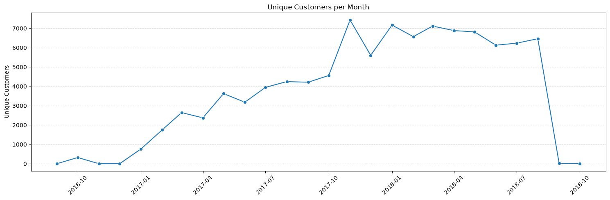

The monthly chart shows how many distinct customers placed an order each month. Average monthly active customers rose from **`2,816`** in January–August `2017` to **`6,670`** in the same months of `2018`—an increase of **`136.8%`**. This reflects increased purchasing activity; it does not mean the monthly counts can be added to find the total customer base. The final months of `2018` are sparse, so they should be interpreted cautiously.

### Repeat Purchases

Among customers with at least one delivered order, **`2,801`** (**`3.0%`**) placed more than one delivered order during the period covered by the data. The other **`97.0%`** had one delivered order. This suggests repeat purchasing was uncommon in the observed period, but it is not a lifetime retention measure: the analysis counts delivered orders only, and the dataset covers a limited time window.

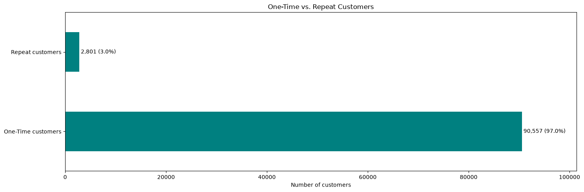

### Top Customers 

The highest-spending customer generated **`R$ 13,440.00`** in product sales from delivered orders. The next two customers generated **`R$ 7,388.00`** and **`R$ 7,160.00`**. The chart compares the ten highest-spending customers; their IDs are anonymized, so it shows the ranking rather than customer names.

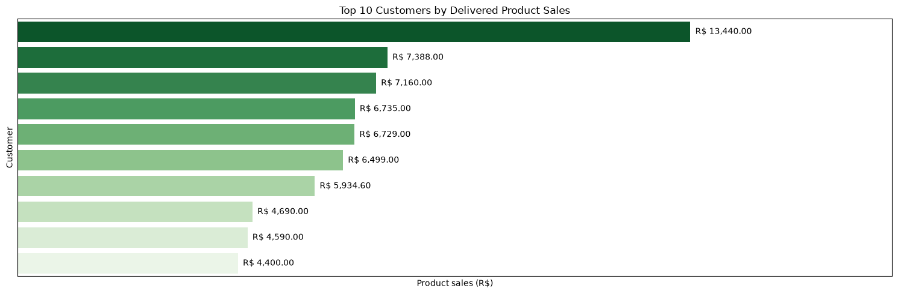

### Customer Locations

Olist's recorded customer locations are concentrated in southeastern Brazil. São Paulo has the largest customer count, with **`40,302`** distinct customer IDs—about **`41.9%`** of the overall **`96,096`**. Rio de Janeiro follows with **`12,384`** (**`12.9%`**), and Minas Gerais with **`11,259`** (**`11.7%`**). São Paulo’s count is more than three times Rio de Janeiro’s, making it the strongest regional center in this dataset.

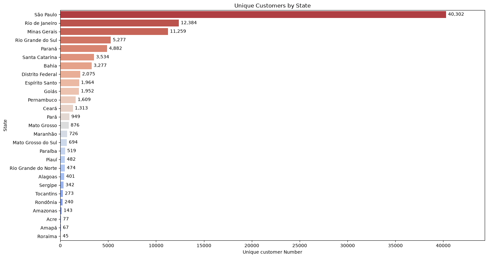

These figures describe the states recorded in the customer data; they do not measure market share or confirm permanent residence. Some customer IDs appear in more than one state, so state counts overlap and should not be summed to calculate the total number of unique customers.

## Product Preformance 

### Category Sales 

Product sales are measured as the sum of item prices for delivered orders. Freight is excluded, so these figures represent the value of delivered products—not profit.

Health & Beauty leads the category ranking at **`R$ 1,233,131.72`**, followed by Watches & Gifts at **`R$ 1,166,176.98`** and Bed, Bath & Table at **`R$ 1,023,434.76`**. Each of the top three exceeded **`R$ 1 million`** in delivered product sales. Health & Beauty holds a modest lead over Watches & Gifts, while the next two categories **Sports & Leisure and Computers & Accessories** fall below **`R$ 1 million`**.

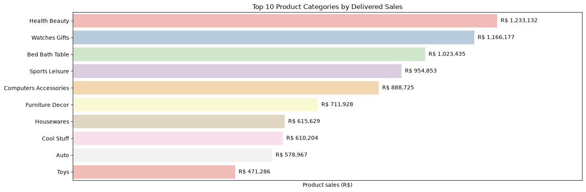

This ranking shows which categories contribute the most product value, but not why. High sales may reflect more orders, more items per order, higher prices, or a combination of these factors. The next analyses of order volume and customer reviews will add context before drawing broader conclusions about category performance.

### Orders by Product Category

Bed Bath Table recorded the most orders, with **`9,417`**, followed by Health & Beauty (**`8,836`**) and Sports & Leisure (**`7,720`**). The lead over Health & Beauty is relatively narrow at **`581`** orders, while the top three categories show the strongest order activity.

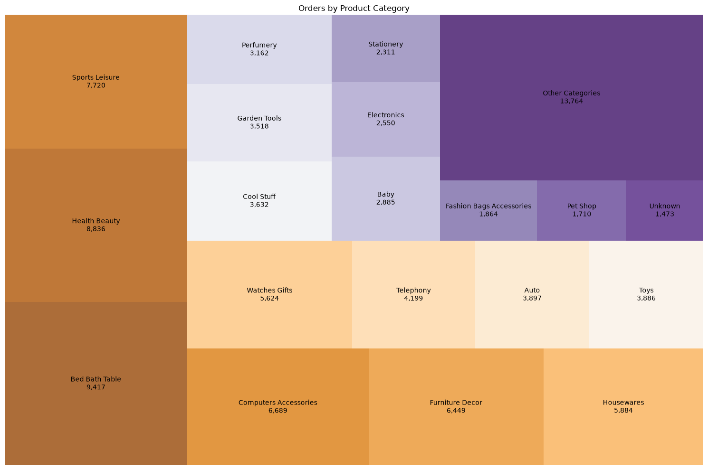

The treemap shows the top 19 named categories; remaining categories are grouped as “Other,” and products without a mapped category are shown as “Unknown.” Counts represent distinct orders containing each category, across all order statuses. Because an order may contain items from several categories, category counts overlap and should not be added to estimate the total number of orders.

### Low-Sales Categories 

Among the ten categories with the lowest delivered product sales, Security & Services ranked lowest at **`R$ 283.29`** across **`2`** delivered orders. Fashion Children's Clothes followed at **`R$ 519.95`** from **`7`** orders, and CDs, DVDs & Musicals at **`R$ 730.00`** from **`12`** orders.

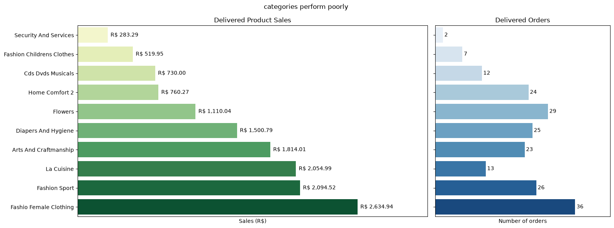

The low sales totals alongside low order counts suggest limited observed sales volume for these categories. However, low sales do not necessarily mean poor profitability or product quality. The analysis measures delivered item prices—not profit—and categories with few orders provide limited evidence for broader conclusions.

These categories are candidates for further review, rather than confirmed poor performers. Order volume and customer review analysis can provide additional context.

### Category Reviews

The chart compares review volume with average scores for the ten categories with the most reviewed orders. The bars show reviewed orders; the line shows the average score out of five. These measures give useful context together: for example, Office Furniture received **`1,263`** reviewed orders and had an average score of **`3.62`**. A larger review volume does not necessarily mean a higher score.

Scores based on very few orders can be unstable. For example, Security & Services averaged **`2.50`** from only **`2`** orders, while CDs, DVDs & Musicals averaged **`4.67`** from **`12`**. These small samples should not be treated as reliable category rankings.

Reviews describe the overall order experience, not an individual product. When an order contains multiple categories, its score is associated with each category; this comparison shows an association, not proof that a category caused a particular rating.

## Delivery Performance — Current Findings

### Average Delivery Time

Across **`96,470`** delivered orders with valid purchase and delivery timestamps, the average time from purchase to customer delivery was **`12.56` days**. This measures the customer’s end-to-end wait, not just the carrier’s transit time. Delivered orders missing a delivery timestamp were excluded.

### Delivery Time and Late Deliveries

- **Orders evaluated:** 96,470
- **Average delivery time:** 12.56 days
- **Late deliveries:** 7,826
- **Late delivery rate:** 8.11%

Delivery time is measured from purchase to customer delivery. An order is considered late when its actual delivery date is after the estimated delivery date; deliveries on or before the estimate are considered on time.

The box plot compares delivery duration for on-time and late orders, while the pie chart shows the share of each group. These results describe delivered orders with valid dates and measure the end-to-end delivery period, not carrier transit time alone.

### Delivery Times Across Brazil

The overall average of **12.56 days** hides a striking geographic difference: all ten states with the longest average delivery times are in Brazil’s **North or Northeast**. Roraima ranks highest at **29.39 days about 2.3 times the overall average** followed by Amapá at **27.19 days** and Amazonas at **26.43 days**.

This pattern is not limited to states with the smallest order counts. Pará averaged **23.77 days across 946 delivered orders**, while Ceará averaged **21.27 days across 1,279**. At the same time, Roraima and Amapá had just **41** and **67** orders, respectively, so their high averages should be treated as noteworthy signals rather than definitive rankings.

Each point represents a state. The horizontal position shows its number of delivered orders, the vertical position shows its average delivery time, and the color reinforces the delivery-time value. This view makes it possible to compare delivery duration with order volume while keeping each state identifiable.

These are **observed averages**, not explanations for why deliveries take longer in particular states. The analysis measures the full period from purchase to customer delivery, not carrier transit time alone.

### Delivery Timeliness and Customer Reviews

Delivery punctuality is strongly associated with customer review scores in this sample. Among **95,824 delivered orders** with valid delivery dates and a recorded review, **88,163 arrived on time** and **7,661 were late**.

On-time orders received an average score of **4.29 out of 5**, with a median of **5**. Late orders averaged **2.57**, with a median of **2**—a **1.72-point difference** on the five-point scale. The 100% stacked chart compares the score distributions within each delivery group, so the much larger on-time group does not dominate the visual comparison.

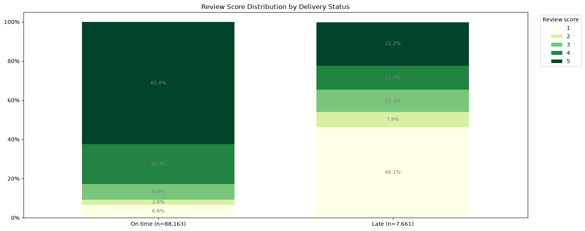

This is an association, not proof that lateness alone caused lower scores. Reviews reflect the overall order experience, which may also depend on product quality, seller service, and other factors. The analysis averages review scores per order before comparing delivery groups, so orders with multiple review records are not counted multiple times.

## Payment Analysis — Current Findings

### Payment Method Usage

<table>
  <tr>
    <td width="48%" valign="middle">
      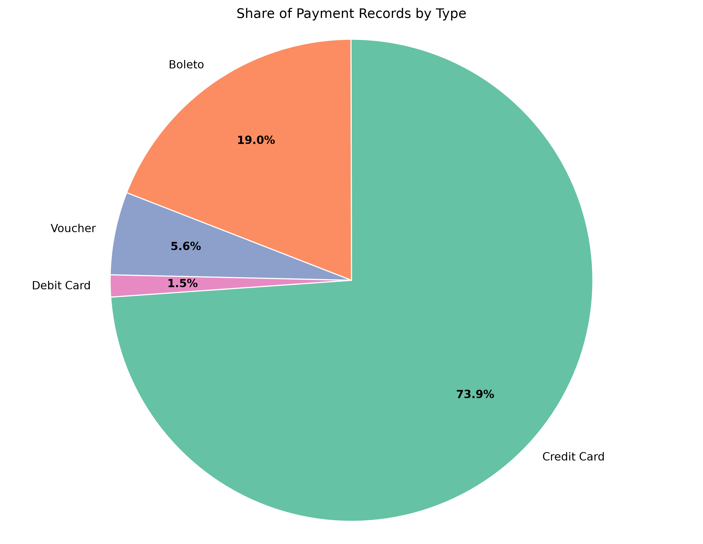
    </td>
    <td width="52%" valign="middle">
      
Credit card accounted for <strong>73.9%</strong> of classified payment records, making it the dominant method. Boleto represented <strong>19.0%</strong>, followed by vouchers at <strong>5.6%</strong> and debit cards at <strong>1.5%</strong>. Three additional records were marked <code>not_defined</code> (less than 0.01%) and are omitted from the chart for readability.

      
The pie chart shows payment-record shares, not shares of unique orders. Some orders used more than one payment method; at the order level, credit card appeared in 76,505 orders (76.94%). Those order-level percentages overlap and therefore should not be represented as pie slices.

    </td>
  </tr>
</table>

### Payment Value by Method

Recorded payment value totals **R$ 16,008,872.12**. Credit cards account for **R$ 12,542,084.19 (78.34%)**, followed by boleto at **R$ 2,869,361.27 (17.92%)**. Together, these methods represent about **96.3%** of the total.

Voucher payments contribute **R$ 379,436.87 (2.37%)**, while debit cards account for **R$ 217,989.79 (1.36%)**. The three `not_defined` records have no recorded payment value and are omitted from the chart.

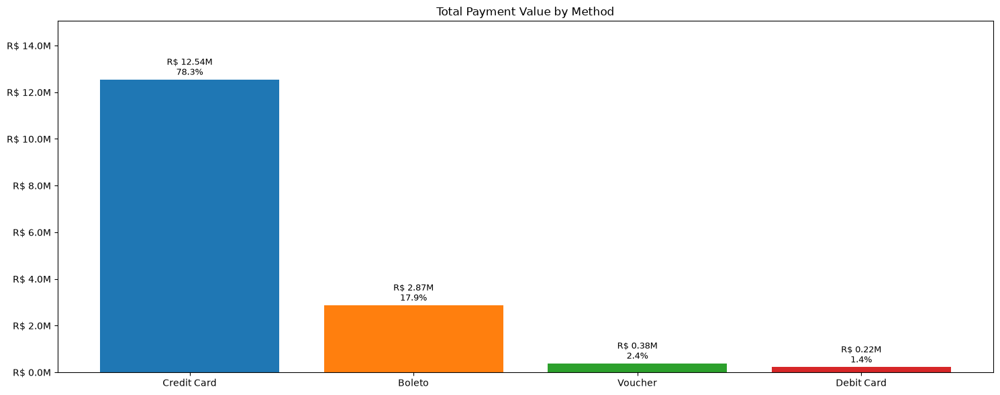

These figures summarize recorded payment amounts, not profit. Since an order can use multiple payment methods, they should not be interpreted as exclusive shares of orders.

### Installment Patterns by Payment Method

The heatmap compares installment-count ranges across payment methods. Each row is normalized to 100%, so the percentages show how payment records are distributed **within each method**. The ranges group payments into 1, 2–3, 4–6, 7–12, and 13 or more installments.

The analysis excludes `not_defined` records and records without a positive installment count. Its unit is the payment record—not the order or the customer—so an order split across payment records may appear more than once. The chart therefore describes the structure of recorded payments, not the percentage of customers who use installments.

### Credit-Card Payment Value by Installment Count

The line chart compares the median recorded payment value across credit-card payment records with different installment counts. Each point represents one installment count; the line connects the observed medians to make the pattern easier to follow.

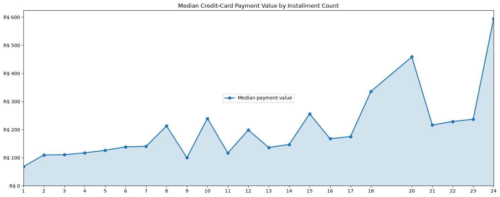

The shaded area extends from the median line to zero for visual emphasis. It does **not** represent a confidence interval or the range of individual payment values. The analysis is at the payment-record level, not the unique-order level, and describes an association—not a causal effect of installment count on payment value. Results at installment counts with fewer records should be interpreted cautiously.

## Seller Performance — Current Findings

### Top Sellers by Sales and Order Volume

The leading sellers differ depending on whether performance is measured by sales or order volume. Seller `4869f7a5` in Guariba, São Paulo, recorded the highest delivered product sales: **R$ 226,987.93 across 1,124 orders**. Seller `53243585` in Lauro de Freitas, Bahia, ranked second in sales at **R$ 217,940.44**, despite having **348 orders**. This corresponds to about **R$ 626 in product sales per seller-order**, compared with about **R$ 202** for the sales leader.

By order volume, seller `6560211a` in São Paulo led with **1,819 delivered orders** and **R$ 120,702.83** in delivered product sales. This difference between the rankings shows that order volume alone does not explain a seller’s total sales value.

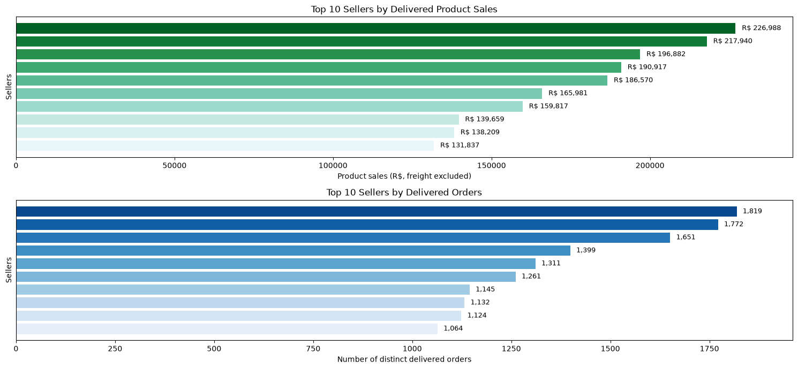

São Paulo is the recorded location for all ten sellers in the top order-volume ranking and nine of the top ten by sales. This describes the leading sellers in these rankings, not the distribution of all sellers or overall market share.

Sales are the sum of item prices for delivered orders; freight is excluded. These figures are not profit. Seller IDs are anonymized, and an order containing items from multiple sellers is counted once for each seller involved.

### Delivery Performance Among High-Volume Sellers

Even among the ten sellers with the most delivered orders, delivery performance varies. Average delivery time ranges from **9.63 to 15.81 days**, while late-delivery rates range from **5.92% to 11.57%**.

The highest-volume seller averaged **9.63 days** and had a **6.43%** late rate across **1,819 orders**. By contrast, the seller with the lowest late rate, **5.92%**, averaged **13.51 days** across **1,064 orders**. This contrast shows that average delivery time and on-time performance are related but distinct measures. The highest late rate in this group was **11.57%**, for a seller averaging **15.06 days** across **1,124 orders**.

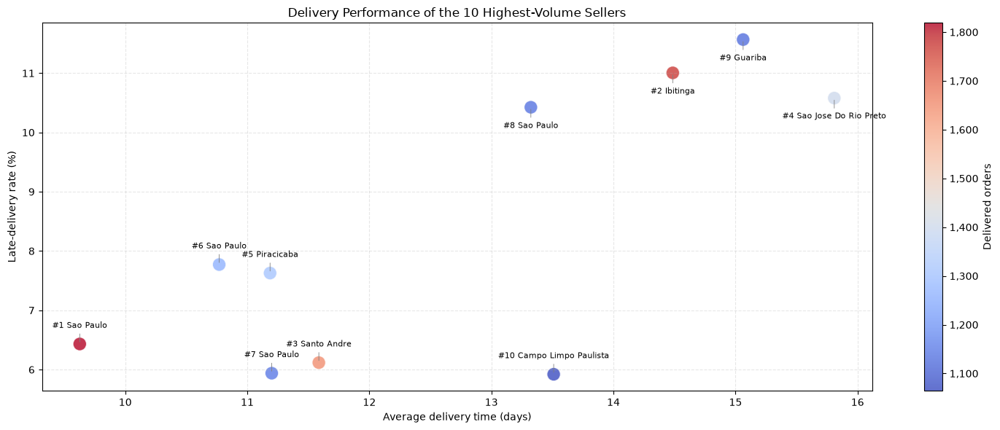

The scatter plot shows average purchase-to-delivery time on the x-axis and late-delivery rate on the y-axis; color represents delivered-order volume. All ten sellers are based in São Paulo state, so this comparison shows variation among high-volume sellers—not differences between states.

Late delivery means the actual customer delivery date was after the estimated date. These are descriptive comparisons and do not account for factors such as customer location or delivery distance, so they should not be read as proof that the seller alone caused the difference.

### Delivery Performance by Seller State

Late-delivery rates vary by seller state, but the amount of supporting data varies widely. São Paulo provides the largest comparison base: **8.67%** of **69,395 seller-order pairs** were late, across **1,769 active sellers**. For additional context, Paraná recorded **6.42%** across **7,556 pairs and 335 sellers**, while Rio de Janeiro recorded **8.39%** across **4,229 pairs and 163 sellers**.

The highest displayed rates require particular caution. Amazonas recorded **66.67%**, but that represents only **2 late deliveries out of 3 pairs from one seller**. Maranhão’s **23.14%** is based on **389 pairs from one seller**, so it reflects that seller’s results rather than a broad state-level pattern. The chart includes pair and seller counts to make these differences in support visible.

A late delivery is one delivered after its estimated date. Counts represent seller-order pairs, not unique marketplace orders: an order involving multiple sellers may contribute to more than one state. These descriptive rates do not account for destination or delivery distance and should not be interpreted as proof that seller location causes delays.

### Sellers with the Highest Low-Review Rates

Among sellers with at least **50 reviewed orders**, seller `1ca7077d` had the highest share of low scores (1–2): **64 of 107 reviewed orders (59.8%)**. Its average score was **2.39**, and its median was **1**. Seller `2eb70248` ranked second, with low scores on **87 of 184 orders (47.3%)**. Across the ten sellers shown, low-score rates ranged from **31.1% to 59.8%**.

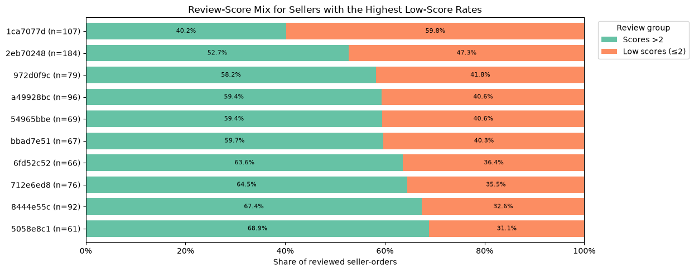

Each bar compares the share of low scores with scores above 2; `n` shows the number of reviewed orders associated with that seller. Because the bars are normalized to 100%, the counts are important context—similar percentages can be based on different numbers of reviews.

This is an aggregate comparison across the observed period, not a month-by-month test of whether low ratings persisted over time. Reviews belong to orders, and an order may include items from multiple sellers, so these results show an association with sellers rather than proving that a seller caused a particular rating. Seller IDs are anonymized.