<p align="center">
  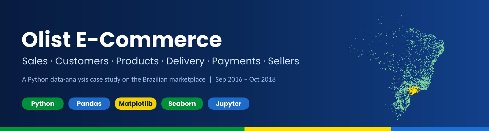
</p>

<p align="center">
  
  
  
  
</p>

<p align="center">
  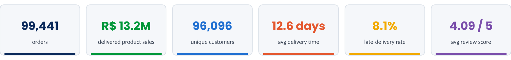
</p>

# Olist E-Commerce Performance Analysis

> **An end-to-end analysis of 99,441 orders from Brazil's Olist marketplace (2016 to 2018): how fast the business grew, who buys, what sells, where delivery breaks down, how Brazilians pay, and which sellers carry the platform.**


## Contents

- [1. Project Overview](#1-project-overview)
  - [1.1 Purpose](#11-purpose)
  - [1.2 Executive Summary](#12-executive-summary)
  - [1.3 Business Questions](#13-business-questions)
  - [1.4 Data Model](#14-data-model)
  - [1.5 Method at a Glance](#15-method-at-a-glance)
- [2. Data Preparation and Quality Assurance](#2-data-preparation-and-quality-assurance)
- [3. Sales Performance: Scale, Seasonality and Growth](#3-sales-performance-scale-seasonality-and-growth)
  - [3.1 Order Volume](#31-order-volume)
  - [3.2 Delivered Product Sales](#32-delivered-product-sales)
  - [3.3 Monthly Trends](#33-monthly-trends)
  - [3.4 Peak and Trough Months](#34-peak-and-trough-months)
  - [3.5 Business Growth](#35-business-growth)
- [4. Customer Analytics: Who Buys, and Do They Return?](#4-customer-analytics-who-buys-and-do-they-return)
  - [4.1 Unique Customers](#41-unique-customers)
  - [4.2 Repeat Purchases](#42-repeat-purchases)
  - [4.3 Top Customers](#43-top-customers)
  - [4.4 Customer Locations](#44-customer-locations)
- [5. Product Performance: What Sells and What Doesn't](#5-product-performance-what-sells-and-what-doesnt)
  - [5.1 Category Sales](#51-category-sales)
  - [5.2 Orders by Product Category](#52-orders-by-product-category)
  - [5.3 Low-Sales Categories](#53-low-sales-categories)
  - [5.4 Category Reviews](#54-category-reviews)
- [6. Delivery Performance: Speed, Reliability and Geography](#6-delivery-performance-speed-reliability-and-geography)
  - [6.1 Average Delivery Time](#61-average-delivery-time)
  - [6.2 Delivery Time and Late Deliveries](#62-delivery-time-and-late-deliveries)
  - [6.3 Delivery Times Across Brazil](#63-delivery-times-across-brazil)
  - [6.4 Delivery Timeliness and Customer Reviews](#64-delivery-timeliness-and-customer-reviews)
- [7. Payment Analysis: How Brazil Pays](#7-payment-analysis-how-brazil-pays)
  - [7.1 Payment Method Usage](#71-payment-method-usage)
  - [7.2 Payment Value by Method](#72-payment-value-by-method)
  - [7.3 Installment Patterns by Payment Method](#73-installment-patterns-by-payment-method)
  - [7.4 Credit-Card Payment Value by Installment Count](#74-credit-card-payment-value-by-installment-count)
- [8. Seller Performance: Concentration, Speed and Service Quality](#8-seller-performance-concentration-speed-and-service-quality)
  - [8.1 Top Sellers by Sales and Order Volume](#81-top-sellers-by-sales-and-order-volume)
  - [8.2 Delivery Performance Among High-Volume Sellers](#82-delivery-performance-among-high-volume-sellers)
  - [8.3 Delivery Performance by Seller State](#83-delivery-performance-by-seller-state)
  - [8.4 Sellers with the Highest Low-Review Rates](#84-sellers-with-the-highest-low-review-rates)
- [9. Strategic Recommendations](#9-strategic-recommendations)
- [10. Limitations and Next Steps](#10-limitations-and-next-steps)
  - [10.1 Limitations](#101-limitations)
  - [10.2 Where a Deeper Analysis Would Go Next](#102-where-a-deeper-analysis-would-go-next)
- [11. Repository Structure](#11-repository-structure)
- [12. How to Run](#12-how-to-run)


## 1. Project Overview

### 1.1 Purpose

This project analyzes historical data from the Brazilian **Olist** e-commerce marketplace to understand business performance and surface actionable trends. Olist is a *marketplace*: independent sellers list products, Olist's logistics partners ship them, and customers review the experience. That three-sided structure shapes every question in this analysis: **demand** (customers), **supply** (sellers and products) and **fulfilment** (delivery).

The dataset is anonymized and covers purchases from **4 September 2016 to 17 October 2018**. The analysis uses **Python, Pandas, Matplotlib and Seaborn**.

### 1.2 Executive Summary

| # | Finding | Evidence |
|:-:|---|---|
| 1 | **Strong growth that levelled off in 2018.** Orders, customers and sales more than doubled year on year, but monthly volume has been flat since early 2018. | Jan–Aug 2018 vs 2017: orders **+135.1%**, sales **+141.1%**. Monthly orders stayed between 6,167 and 7,269 from January to August 2018. |
| 2 | **Growth is acquisition-led; retention is the biggest untapped lever.** | Only **3.0%** of customers placed a second delivered order. |
| 3 | **Sales are broad-based, not dependent on a few products or customers.** | Top 3 categories = **25.9%** of delivered product value; top 10% of customers = **41.1%**. |
| 4 | **Delivery speed is a geographic story; delivery reliability is a regional-operations story.** | São Paulo averages **8.8 days**, Roraima **29.4**. Alagoas (**23.9%**) and Maranhão (**19.7%**) have the highest late rates, not the most remote states. |
| 5 | **Late delivery is the clearest driver of unhappy customers.** | Average review **4.29** on time vs **2.57** late; **46%** of late orders get 1 star. |
| 6 | **Credit cards and installments dominate payments.** | Credit card = **78.3%** of payment value; **66.9%** of card payments are split into installments. |
| 7 | **The seller base is concentrated and São Paulo-centric.** | Top 20% of sellers = **82.3%** of sales; São Paulo hosts **59.7%** of sellers and **64.4%** of sales. |

<p align="center">
  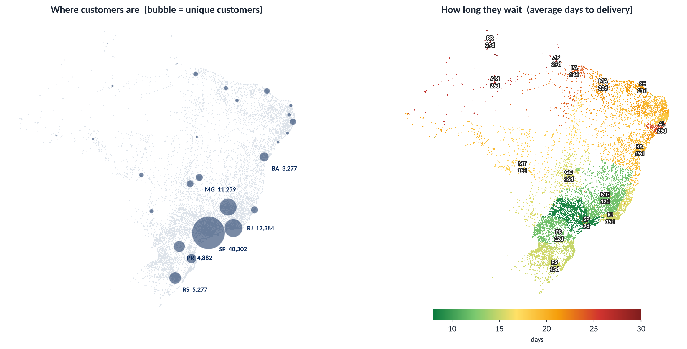
</p>
<p align="center"><sub><b>Brazil at a glance.</b> Left: demand is concentrated in the Southeast. Right: delivery time grows with distance from São Paulo. Both maps are drawn from the dataset's own geolocation points (738,332 unique coordinates).</sub></p>

### 1.3 Business Questions

| Area | Questions answered |
|---|---|
| **Sales** | How many orders and how much product value ? <br> How do they move month by month ? <br> Which months peak ? <br> Is the business growing ? |
| **Customers** | How many unique customers ? <br> How many return ? <br> Who spends most ? <br> Where do they live ? |
| **Products** | Which categories earn the most? Which get the most orders ? <br> Which underperform ? <br> How do categories relate to reviews ? |
| **Delivery** | How long does delivery take ? <br> How many orders are late? Which states wait longest ? <br> Does lateness hurt satisfaction ? |
| **Payments** | Which methods are used most and carry the most value ? <br> How are installments used ? |
| **Sellers** | Who leads on sales and volume? How reliable are the top sellers ? <br> Does seller location matter ? <br> Which sellers receive poor reviews ? |


### 1.4 Data Model

The data comes as **nine relational tables**. Orders sit at the centre and connect to customers, items, payments and reviews; items connect onward to products and sellers; ZIP-code prefixes link customers and sellers to geolocation.

<p align="center">
  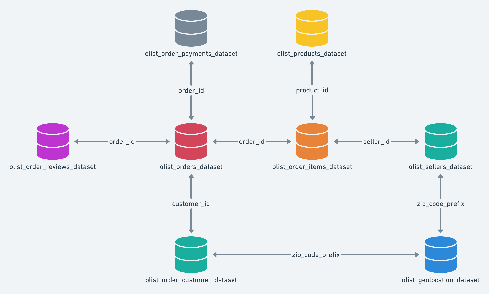
</p>
<p align="center"><sub>Database structure of the Olist dataset. In the CSV files the customer table is <code>olist_customers_dataset.csv</code>.</sub></p>

| Table | Rows | Grain (one row per…) |
|---|--:|---|
| `olist_orders_dataset` | 99,441 | order |
| `olist_customers_dataset` | 99,441 | customer **ID per order** (`customer_unique_id` identifies the person) |
| `olist_order_items_dataset` | 112,650 | item within an order |
| `olist_order_payments_dataset` | 103,886 | payment record (an order can have several) |
| `olist_order_reviews_dataset` | 99,224 | review (an order can have more than one) |
| `olist_products_dataset` | 32,951 | product |
| `olist_sellers_dataset` | 3,095 | seller |
| `olist_geolocation_dataset` | 1,000,163 → 738,332 | coordinate per ZIP prefix (after de-duplication) |
| `product_category_name_translation` | 71 | Portuguese → English category name |

> [!TIP]
> **Analyst's note: know your grain.** Each table has a different unit of observation, so "how many?" has a different answer depending on the table. Throughout this project every chart and number states its unit: *orders*, *items*, *payment records*, *seller-order pairs* or *customers*. Mixing them is the most common source of silently wrong KPIs.

### 1.5 Method at a Glance

**Load → Inspect → Clean → Join → Aggregate → Visualize → Interpret.** Joins were written with Pandas' `validate=` argument (for example `many_to_one`) so that an unexpected duplicate key stops the notebook instead of silently multiplying rows. Distinct counts use `nunique()` on the right identifier, and review scores are averaged *per order* before comparisons so an order with several reviews is not counted several times.

<details>
<summary><b>Metric dictionary: how every number in this report is defined</b> (click to expand)</summary>

<br>

| Metric | Definition | Why it matters |
|---|---|---|
| **Delivered product sales** | Sum of item `price` for orders with status `delivered`. **Excludes freight.** | Closest available proxy for marketplace sales (GMV). It is **not** revenue or profit. |
| **Delivery time** | Customer delivery timestamp minus purchase timestamp, in days (delivered orders with both dates). | Measures the customer's full wait, including approval, seller handling and carrier transit. |
| **Late delivery** | Delivered after the *estimated* delivery date. On or before the estimate = on time. | Compares performance with the promise made at checkout. |
| **Unique customer** | Distinct `customer_unique_id`. | `customer_id` is generated per order, so counting it would overstate customers (99,441 vs 96,096). |
| **Repeat customer** | A `customer_unique_id` with more than one *delivered* order in the data window. | A window-limited signal, not lifetime retention. |
| **Low review** | Review score of 1 or 2 out of 5. | Standard "detractor-like" cut used for seller screening. |
| **Seller-order pair** | One seller within one order. | An order with items from two sellers counts once for each. |

</details>


## 2. Data Preparation and Quality Assurance

The guiding principle was **fix what is demonstrably wrong, never invent what is unknown**. The original CSV files were left untouched; all cleaning happens in memory.

| Step | What was found | Decision |
|---|---|---|
| **Date handling** | Timestamps in orders, order items and reviews were stored as text. | Converted to `datetime` with `errors="raise"`, so any malformed date would have stopped the run. |
| **Missing values** | **Orders:** most missing dates match the order's status (canceled or not yet delivered). A few `delivered` orders lack dates: 14 approval, 2 carrier and 8 customer-delivery timestamps. **Reviews:** 88.34% of titles and 58.70% of comments are blank (both optional). **Products:** 610 rows lack category, name length, description length and photo count together; 2 lack weight and dimensions. | Left blank, **no imputation and no rows removed**. Calculations exclude missing values explicitly and say so. |
| **Duplicates** | All nine tables were checked for identical rows. Only the geolocation table had exact repeats. | **261,831** exact duplicates removed (1,000,163 → 738,332 rows). Different locations sharing a ZIP prefix were kept. |

> [!NOTE]
> **Why not impute?** A missing delivery date on a *delivered* order is a data-quality signal, not a gap to paper over. Imputing it would manufacture precision the data does not have. Missing values were also kept because their pattern is informative: product fields go missing *together*, which points to an upstream listing issue rather than random noise.

> [!TIP]
> **Analyst's note: the geolocation table is not unique per ZIP prefix.** It holds many coordinates for each prefix, so joining it directly to customers or sellers would multiply rows. Aggregate it first (for example, to a median latitude/longitude per prefix) before any join. The maps in this project use the de-duplicated points directly.


## 3. Sales Performance: Scale, Seasonality and Growth

### 3.1 Order Volume

The orders table contains **99,441** order records. **97.0%** (96,478) reached the *delivered* status; the rest were shipped (1.1%), canceled (0.6%), unavailable (0.6%) or still being processed.

### 3.2 Delivered Product Sales

The total value of product prices for delivered orders is **R$ 13,221,498.11**. This sums item prices and excludes freight: it is the product value associated with delivered orders, not profit or net accounting revenue.

| Basket metric (delivered orders) | Value |
|---|--:|
| Average order value (product price) | **R$ 137.04** |
| Median order value | **R$ 86.57** |
| Items per order | **1.14** (90.0% of orders contain a single item) |
| Freight paid on top of product value | **R$ 2.20M** (16.6% of product value) |

> [!TIP]
> **Analyst's note: the mean is double the median.** A handful of high-value orders pull the average (R$ 137) well above the typical basket (R$ 87). For pricing and promotion decisions, the median describes the *typical* customer better. Freight adding roughly one-sixth to the cost of every product is a meaningful friction point for a marketplace shipping across a country this large.

### 3.3 Monthly Trends

<p align="center">
  
</p>

Order volume and delivered product sales rose steadily from late 2016 through 2017, then **fluctuated within a band** during 2018 rather than continuing to climb.

The final months should be read with care. They may be incomplete, and because sales count only delivered orders, recent purchases may not yet appear in delivered sales. The data holds just 16 orders for September 2018 and 4 for October 2018, a clear sign of a data cut-off rather than a collapse in demand.

### 3.4 Peak and Trough Months

| Rank | Highest delivered sales | Amount |
|:-:|---|--:|
| 1 | **November 2017** | **R$ 987,765.37** |
| 2 | **May 2018** | **R$ 977,544.69** |
| 3 | **April 2018** | **R$ 973,534.09** |

Among months with recorded sales, the lowest totals were **December 2016** (R$ 10.90), **September 2016** (R$ 134.97) and **October 2016** (R$ 40,325.11). No delivered sales were recorded for **November 2016**, **September 2018** or **October 2018**. This does not necessarily mean no orders were placed; some orders may not have been delivered when the dataset was recorded.

> [!TIP]
> **Analyst's note: the November 2017 spike.** Orders jumped **62.9%** in a single month (4,631 in October to 7,544 in November), and the month coincides with Brazil's **Black Friday (24 November 2017)**. That is a plausible driver but it was not tested here. If it holds, it matters operationally: delivery capacity and seller stock must be ready for a promotion-driven surge. Tracking the *following* month (December 2017: 5,673 orders) would show how much of the peak was pulled forward from regular demand.

### 3.5 Business Growth

Comparing **January–August 2017 with January–August 2018**, the same eight months so that seasonality cancels out:

<p align="center">
  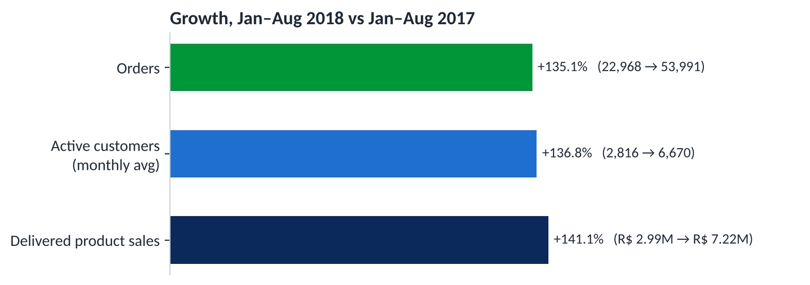
</p>

Together these results point to **strong growth in observed marketplace activity** over the comparable period. Sales grew slightly faster than orders and customers, which hints at a modest increase in spend per order alongside the volume gain (orders count all statuses while sales count delivered orders only, so the gap is indicative, not exact).

> [!IMPORTANT]
> **What this comparison does not measure.** It is not profit: orders include all statuses, delivered product sales exclude freight, and the sparse September–October 2018 data is deliberately excluded from the trend. Sales here means the value of products in delivered orders. It does not include shipping costs or business expenses.


## 4. Customer Analytics: Who Buys, and Do They Return?

### 4.1 Unique Customers

Olist recorded **96,096** distinct customers. The customer table holds **99,441** order-level records, so those rows must not be read as distinct people: some customers appear in more than one order.

<p align="center">
  
</p>

The chart shows how many distinct customers ordered each month. Average monthly active customers rose from **2,816** (Jan–Aug 2017) to **6,670** (Jan–Aug 2018), an increase of **136.8%**. This reflects increased purchasing activity; monthly counts cannot be added together to get the total customer base, because the same person can be active in several months. The final months of 2018 are sparse and should be read cautiously.

### 4.2 Repeat Purchases

Among customers with at least one delivered order, **2,801 (3.0%)** placed more than one delivered order in the period covered. The other **97.0%** had one.

<p align="center">
  
</p>

Repeat purchasing was uncommon in the observed window. This is not a lifetime-retention measure: it counts delivered orders only, and the data covers a limited time span.

> [!TIP]
> **Analyst's note: why 3% is a big deal.** With 97% of buyers purchasing once, almost every order in the 2017–2018 growth came from *newly acquired* customers, and acquisition is the most expensive way to grow. Even lifting the repeat rate by a few points would add orders at a fraction of acquisition cost. A natural next step is **cohort analysis**: group customers by first-purchase month and track what share return in months 1, 2, 3.

### 4.3 Top Customers

The highest-spending customer generated **R$ 13,440.00** in delivered product sales; the next two generated **R$ 7,388.00** and **R$ 7,160.00**. IDs are anonymized, so the chart shows the ranking rather than names.

<p align="center">
  
</p>

> [!TIP]
> **Analyst's note: spend is spread out.** Even the single largest customer is a tiny fraction of the total, and the top 10% of customers account for **41.1%** of delivered product value (the top 1% for **11.5%**). Revenue is not "whale-dependent": no single customer or small group drives the business, so customer-level concentration risk is low.

### 4.4 Customer Locations

Recorded customer locations are concentrated in southeastern Brazil. **São Paulo** has the most distinct customer IDs: **40,302**, about **41.9%** of the overall 96,096. **Rio de Janeiro** follows with **12,384** (12.9%) and **Minas Gerais** with **11,259** (11.7%). São Paulo's count is more than three times Rio's, which makes it the strongest regional center in this dataset. The four Southeastern states together account for roughly **69%** of customers.

<table>
  <tr>
    <td width="46%" valign="top">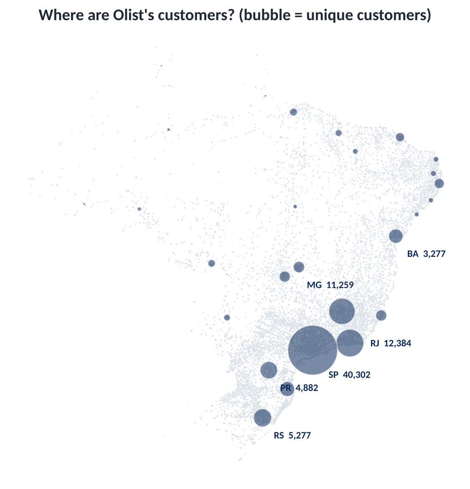</td>
    <td width="54%" valign="top">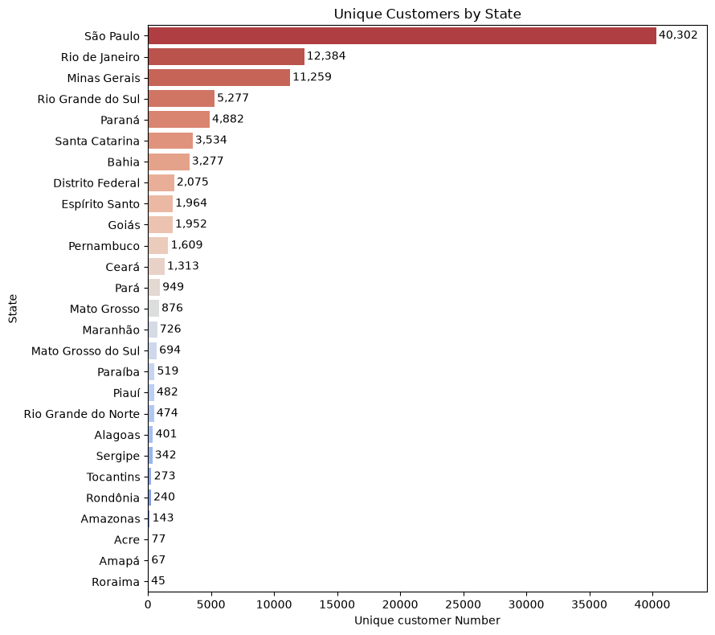</td>
  </tr>
</table>

These figures describe the states recorded in the customer data; they do not measure market share or confirm permanent residence. Some customer IDs appear in more than one state, so state counts overlap and should not be summed to get the total.


## 5. Product Performance: What Sells and What Doesn't

### 5.1 Category Sales

Product sales are the sum of item prices for delivered orders (freight excluded), so they represent delivered product value, not profit.

**Health & Beauty** leads at **R$ 1,233,131.72**, followed by **Watches & Gifts** at **R$ 1,166,176.98** and **Bed, Bath & Table** at **R$ 1,023,434.76**. Each of the top three exceeded R$ 1 million. Health & Beauty holds a modest lead over Watches & Gifts, while the next two categories, **Sports & Leisure** and **Computers & Accessories**, fall below R$ 1 million.

<p align="center">
  
</p>

This ranking shows which categories contribute the most product value, but not *why*. High sales may reflect more orders, more items per order, higher prices, or a combination.

> [!TIP]
> **Analyst's note: price × volume.** The category mix is diversified: the top 3 categories hold **25.9%** of sales and the top 10 hold **62.4%** across 71 categories. Looking at the two drivers separately shows different strategies: **Watches & Gifts** earns through a high average item price (**R$ 199**), while **Bed, Bath & Table** earns through volume (most orders of any category) at a lower price (**R$ 93**).

### 5.2 Orders by Product Category

**Bed, Bath & Table** recorded the most orders with **9,417**, followed by **Health & Beauty** (**8,836**) and **Sports & Leisure** (**7,720**). The lead over Health & Beauty is narrow (**581** orders), and the top three show the strongest order activity.

<p align="center">
  
</p>

The treemap shows the top 19 named categories; the remainder are grouped as "Other" and products without a mapped category as "Unknown". Counts are distinct orders containing each category, across all statuses. Because one order can include several categories, category counts overlap and should not be added up to estimate total orders.

### 5.3 Low-Sales Categories

Among the ten categories with the lowest delivered product sales, **Security & Services** ranked lowest at **R$ 283.29** across **2** delivered orders. **Fashion Children's Clothes** followed at **R$ 519.95** from **7** orders, and **CDs, DVDs & Musicals** at **R$ 730.00** from **12**.

<p align="center">
  
</p>

Low sales alongside low order counts suggest limited observed volume. Low sales do not necessarily mean poor profitability or quality: the analysis measures delivered item prices, not profit, and categories with few orders provide limited evidence. Treat them as **candidates for further review**, not confirmed poor performers.

### 5.4 Category Reviews

The chart pairs review volume (bars) with the average score out of five (line) for the ten categories with the most reviewed orders. For example, Office Furniture received **1,263** reviewed orders at an average of **3.62**. More reviews do not necessarily mean higher scores.

<p align="center">
  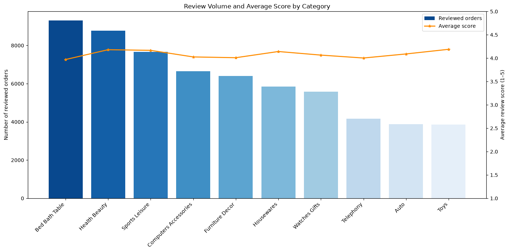
</p>

Scores based on very few orders are unstable: Security & Services averaged **2.50** from only **2** orders, while CDs, DVDs & Musicals averaged **4.67** from **12**. Such small samples should not be treated as reliable rankings. Reviews also describe the *whole order experience*, not an individual product, and when an order spans several categories its score is attached to each, so this shows an association, not proof that a category caused a rating.


## 6. Delivery Performance: Speed, Reliability and Geography

### 6.1 Average Delivery Time

Across **96,470** delivered orders with valid purchase and delivery timestamps, the average time from purchase to delivery was **12.56 days**. This is the customer's end-to-end wait, not just carrier transit time. Delivered orders missing a delivery timestamp were excluded.

<p align="center">
  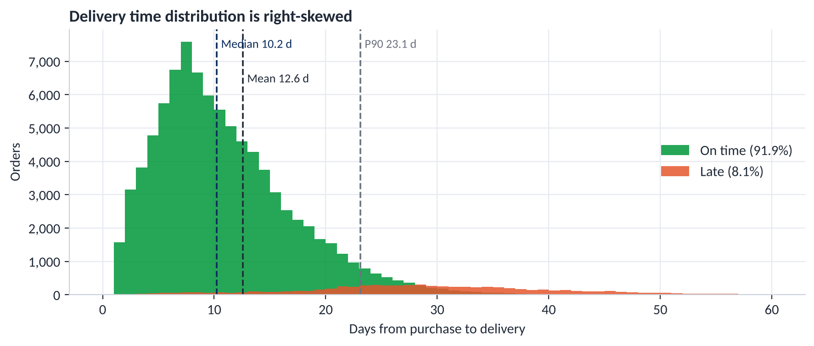
</p>

> [!TIP]
> **Analyst's note: look past the average.** The distribution has a long right tail: the **median is 10.2 days**, the mean 12.6 and the **90th percentile 23.1 days**. One in ten customers waits more than three weeks. Averages hide that tail; percentiles are the right way to describe a delivery promise.

### 6.2 Delivery Time and Late Deliveries

| Indicator | Value |
|---|--:|
| Orders evaluated | **96,470** |
| Average delivery time | **12.56 days** |
| Late deliveries | **7,826** |
| Late-delivery rate | **8.11%** |

An order is **late** when its actual delivery date is after the estimated delivery date; on or before the estimate counts as on time.

<p align="center">
  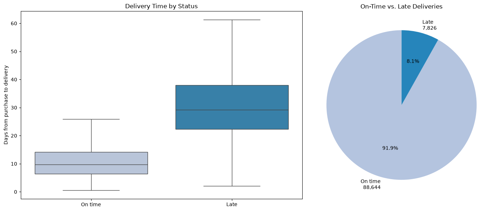
</p>

The box plot compares delivery duration for on-time and late orders; the pie chart shows each group's share. Late orders took **31.5 days** on average versus **10.9 days** for on-time orders.

> [!TIP]
> **Analyst's note: the estimate is padded.** The average promised delivery window is **23.7 days**, almost double the **12.6 days** actually taken. On-time orders arrive on average **13.0 days earlier** than promised, while late orders arrive **9.6 days after** the promise. Conservative estimates keep the late rate low (8.1%) but may also make Olist look slow at checkout. Whether tighter, region-specific promises would raise conversion without raising lateness is a testable hypothesis (see Section 9).

### 6.3 Delivery Times Across Brazil

The overall average of **12.56 days** hides a striking geographic difference. All ten states with the longest average delivery times are in Brazil's **North or Northeast**. **Roraima** ranks highest at **29.39 days** (about 2.3 times the overall average), followed by **Amapá** at **27.19** and **Amazonas** at **26.43**. **São Paulo**, by contrast, averages just **8.76 days**.

<p align="center">
  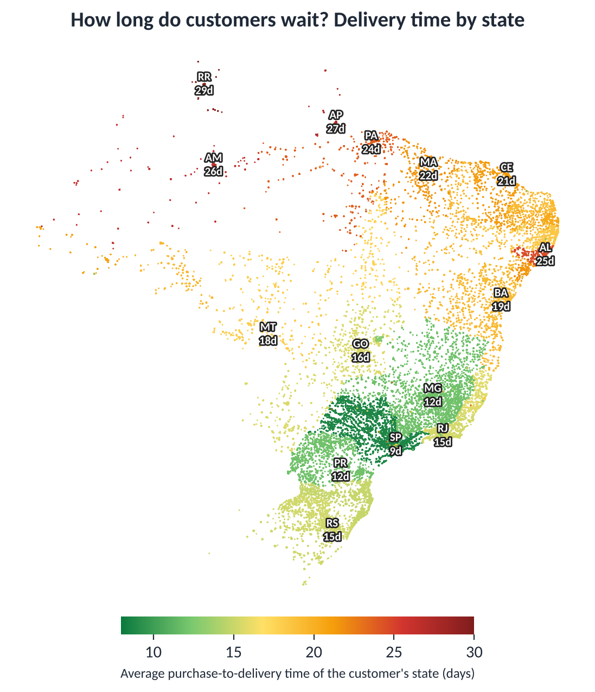
</p>

The pattern is not limited to states with the fewest orders. **Pará** averaged **23.77 days across 946** delivered orders and **Ceará 21.27 days across 1,279**. At the same time, Roraima and Amapá had just **41** and **67** orders, so their averages are noteworthy signals rather than definitive rankings.

<p align="center">
  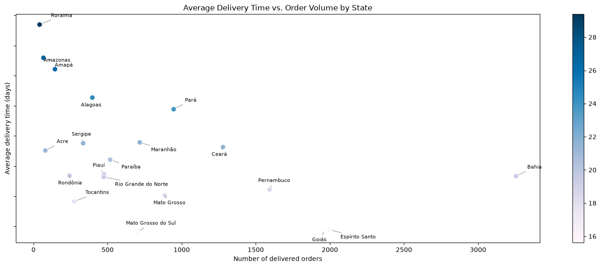
</p>

Each point is a state: horizontal position is its number of delivered orders, vertical position its average delivery time, and color reinforces the delivery-time value. These are **observed averages**, not explanations for why deliveries take longer in particular states.

> [!IMPORTANT]
> **Long is not the same as late.** Ranking states by *late rate* gives a different picture from ranking them by *delivery time*. The remote states with the longest waits (Roraima 12.2%, Amapá 4.5%, Amazonas 4.1%) mostly meet their longer promises. The worst reliability is in the **Northeast**: **Alagoas 23.9%** (397 orders) and **Maranhão 19.7%** (717 orders), against **5.0–5.9%** in Paraná, Minas Gerais and São Paulo. Distance explains *slow*; it does not explain *unreliable*. That points to regional carrier performance rather than geography alone.

<p align="center">
  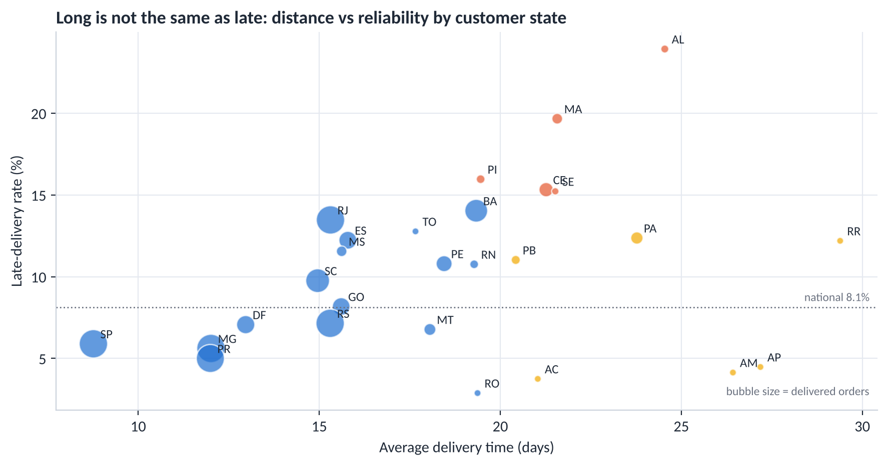
</p>

### 6.4 Delivery Timeliness and Customer Reviews

Delivery punctuality is **strongly associated** with review scores. Among **95,824** delivered orders with valid dates and a recorded review, **88,163 arrived on time** and **7,661 were late**.

| Group | Orders | Average score | Median score |
|---|--:|:-:|:-:|
| On time | 88,163 | **4.29** | 5 |
| Late | 7,661 | **2.57** | 2 |
| **Difference** | | **1.72 points** | |

<p align="center">
  
</p>

The 100% stacked chart compares score distributions *within* each group, so the much larger on-time group does not dominate the visual. Most strikingly, **46%** of late orders received the lowest score (1 star), versus only **7%** of on-time orders.

This is an association, not proof that lateness alone caused the lower scores: reviews reflect the overall experience, including product quality and seller service. Review scores were averaged per order before comparing groups, so orders with multiple review records are not double counted.

> [!TIP]
> **Analyst's note: the promise matters more than the speed.** A customer who waited 20 days for an order promised in 30 is more likely to be satisfied than one who waited 12 days for an order promised in 10. Satisfaction tracks *meeting expectations*, so the delay itself (days beyond the estimate) is a more powerful KPI than raw delivery time.


## 7. Payment Analysis: How Brazil Pays

### 7.1 Payment Method Usage

<table>
  <tr>
    <td width="48%" valign="middle">
      
    </td>
    <td width="52%" valign="middle">
      <p><strong>Credit card</strong> accounted for <strong>73.9%</strong> of classified payment records, making it the dominant method. <strong>Boleto</strong> represented <strong>19.0%</strong>, followed by <strong>vouchers</strong> at <strong>5.6%</strong> and <strong>debit cards</strong> at <strong>1.5%</strong>. Three records were marked <code>not_defined</code> (under 0.01%) and are omitted from the chart for readability.</p>
      <p>The pie shows payment-<em>record</em> shares, not shares of unique orders. Some orders used more than one method; at the order level, credit card appeared in <strong>76,505 orders (76.94%)</strong>. Those order-level percentages overlap, so they are not shown as pie slices.</p>
    </td>
  </tr>
</table>

### 7.2 Payment Value by Method

Recorded payment value totals **R$ 16,008,872.12**. **Credit cards** account for **R$ 12,542,084.19 (78.34%)**, followed by **boleto** at **R$ 2,869,361.27 (17.92%)**: together about **96.3%** of the total. **Vouchers** contribute **R$ 379,436.87 (2.37%)** and **debit cards R$ 217,989.79 (1.36%)**. The three `not_defined` records have no recorded value.

<p align="center">
  
</p>

These figures summarize recorded payment amounts, not profit, and since an order can use several methods they should not be read as exclusive shares of orders.

> [!WARNING]
> **Do not compare payments with product sales.** Payment value (R$ 16.01M) is higher than delivered product sales (R$ 13.22M) because payments also cover **freight** and include orders that were never delivered. The two figures answer different questions.

> [!TIP]
> **Analyst's note: credit cards carry more value than their share of transactions.** Cards are 73.9% of payment records but **78.3%** of value, while boleto's share *shrinks* from 19.0% of records to 17.9% of value. Card payers tend to spend more per payment, consistent with the installment behavior shown below.

### 7.3 Installment Patterns by Payment Method

The heatmap compares installment-count ranges across payment methods. Each row is normalized to 100%, so the percentages show how payment records are distributed **within each method**, grouped into 1, 2–3, 4–6, 7–12 and 13+ installments.

<p align="center">
  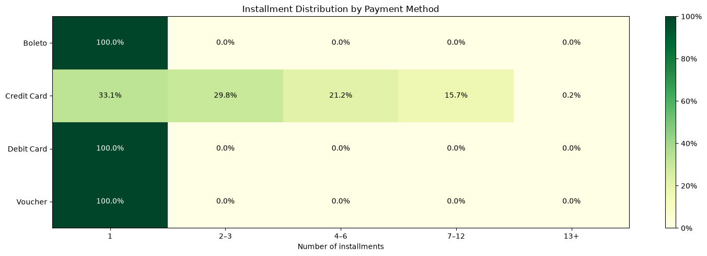
</p>

The analysis excludes `not_defined` records and records without a positive installment count. Its unit is the *payment record*, not the order or customer, so an order split across several records may appear more than once. It describes the structure of recorded payments, not the percentage of customers who use installments.

> [!TIP]
> **Analyst's note: installments are a credit-card phenomenon.** Boleto, debit card and voucher payments are **100% single-payment**. Among credit-card records, only **33.1%** are paid in one go; **66.9%** use installments (average **3.5**). Installments (*parcelado*) are a core part of how Brazilians finance purchases, so a checkout without them would likely hurt conversion.

### 7.4 Credit-Card Payment Value by Installment Count

The chart compares the **median** recorded payment value across credit-card records with different installment counts. Each point is one installment count; the line connects observed medians to make the pattern easier to follow.

<p align="center">
  
</p>

The shaded area runs from the median line to zero for visual emphasis; it is **not** a confidence interval. The analysis is at payment-record level and shows an association, not a causal effect of installments on payment value. Results at installment counts with few records should be interpreted cautiously.

> [!TIP]
> **Analyst's note: bigger tickets are split into more installments.** The median single-installment payment is **R$ 67.87**, versus **R$ 239.74** for 10 installments. Installment counts cluster at 1–6, 8 and 10 (**5,328** records at 10 versus just **644** at 9), which suggests retailers cap installment plans at set limits such as "up to 10x". That is a hypothesis worth confirming with seller-level data. Beyond roughly 12 installments there are very few records and the median becomes volatile.


## 8. Seller Performance: Concentration, Speed and Service Quality

### 8.1 Top Sellers by Sales and Order Volume

The leaders differ depending on whether performance is measured by sales or by volume. Seller `4869f7a5` in Guariba, São Paulo recorded the highest delivered product sales: **R$ 226,987.93 across 1,124 orders**. Seller `53243585` in Lauro de Freitas, Bahia ranked second at **R$ 217,940.44** from only **348 orders**: about **R$ 626 per seller-order**, compared with about **R$ 202** for the sales leader.

By volume, seller `6560211a` in São Paulo led with **1,819 delivered orders** and **R$ 120,702.83** in sales. The difference between the rankings shows that order volume alone does not explain total sales value.

<p align="center">
  
</p>

São Paulo is the recorded location of all ten sellers in the order-volume ranking and nine of the top ten by sales. This describes the *leading* sellers, not the distribution of all sellers or overall market share. Sales are item prices on delivered orders (freight excluded), not profit; seller IDs are anonymized, and an order with items from several sellers is counted once per seller.

<table>
  <tr>
    <td width="50%" valign="top">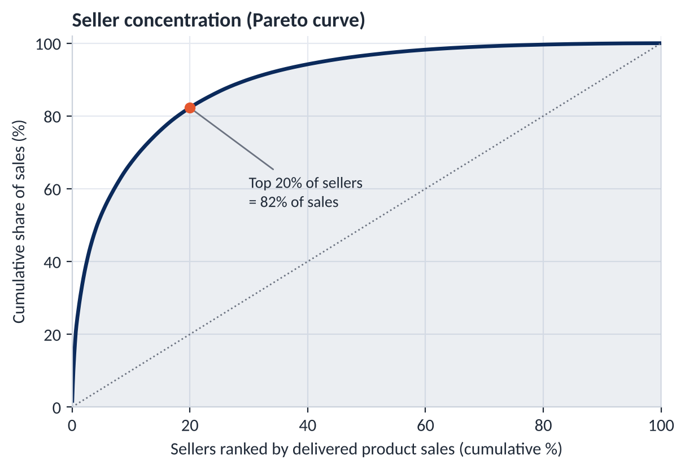</td>
    <td width="50%" valign="top">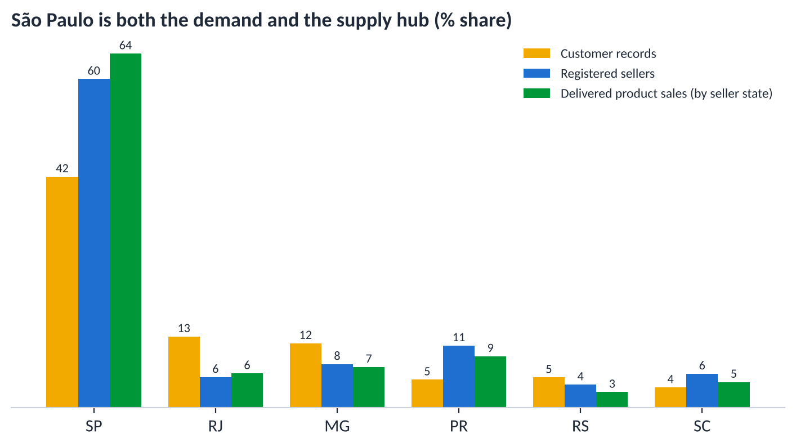</td>
  </tr>
</table>

> [!TIP]
> **Analyst's note: a classic Pareto marketplace.** Of the **2,970** sellers with delivered sales, the **top 20% (about 594 sellers) generate 82.3%** of product value, and just **533 sellers** produce 80%. The single biggest seller is only about 1.7% of sales, so there is no single point of failure, but a small group of sellers carries the platform. **São Paulo** is both the demand center (41.9% of customers) and the supply center (**59.7% of registered sellers, 64.4% of sales**), which is why São Paulo customers get the fastest delivery.

### 8.2 Delivery Performance Among High-Volume Sellers

Even among the ten sellers with the most delivered orders, performance varies. Average delivery time ranges from **9.63 to 15.81 days**, and late-delivery rates from **5.92% to 11.57%**.

The highest-volume seller averaged **9.63 days** with a **6.43%** late rate across **1,819 orders**. The seller with the lowest late rate, **5.92%**, averaged **13.51 days** across **1,064 orders**. The highest late rate in the group was **11.57%**, for a seller averaging **15.06 days** across **1,124 orders**. Average delivery time and on-time performance are related but distinct measures.

<p align="center">
  
</p>

The scatter plots average purchase-to-delivery time (x) against late-delivery rate (y), with color showing delivered-order volume. All ten sellers are in São Paulo state, so this shows variation *among* high-volume sellers, not differences between states. The comparison is descriptive and does not account for customer location or delivery distance, so it should not be read as proof that the seller alone caused the difference.

### 8.3 Delivery Performance by Seller State

Late-delivery rates vary by seller state, but the amount of supporting data varies enormously. **São Paulo** provides the largest base: **8.67%** of **69,395 seller-order pairs** were late, across **1,769 active sellers**. **Paraná** recorded **6.42%** across **7,556 pairs and 335 sellers**, and **Rio de Janeiro 8.39%** across **4,229 pairs and 163 sellers**.

The highest displayed rates need particular caution. **Amazonas** shows **66.67%**, but that is **2 late deliveries out of 3 pairs from one seller**. **Maranhão's 23.14%** rests on **389 pairs from a single seller**, so it reflects that seller rather than a state-wide pattern. The chart includes pair and seller counts to make the differences in support visible.

<p align="center">
  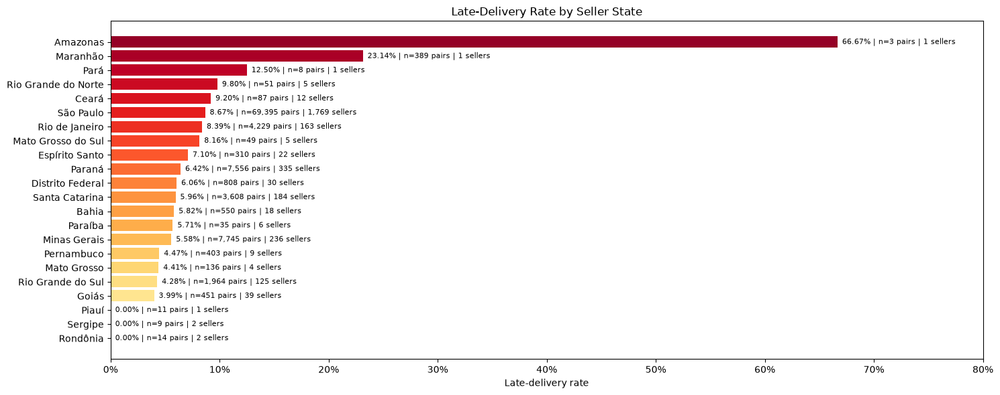
</p>

A late delivery is one delivered after its estimated date. Counts are seller-order pairs, not unique marketplace orders. These descriptive rates do not account for destination or distance and should not be read as proof that seller location causes delays.

### 8.4 Sellers with the Highest Low-Review Rates

Among sellers with at least **50 reviewed orders**, seller `1ca7077d` had the highest share of low scores (1–2): **64 of 107 reviewed orders (59.8%)**, with an average score of **2.39** and a median of **1**. Seller `2eb70248` ranked second with low scores on **87 of 184 orders (47.3%)**. Across the ten sellers shown, low-score rates ranged from **31.1% to 59.8%**.

<p align="center">
  
</p>

Each bar compares the share of low scores with scores above 2; `n` is the number of reviewed orders for that seller. Because bars are normalized to 100%, the counts are essential context: similar percentages can rest on very different review volumes.

This is an aggregate comparison across the observed period, not a month-by-month test of whether poor ratings persisted. Reviews belong to orders, and an order can include several sellers, so results show an association with sellers rather than proof that a seller caused a rating. Seller IDs are anonymized.

> [!TIP]
> **Analyst's note: the 50-review threshold is doing real work.** Without a minimum sample, sellers with two or three reviews would dominate a "worst seller" list through chance alone. For a production scorecard, consider confidence intervals (such as Wilson) or shrinkage toward the platform average, and check whether poor-rated sellers are also the *late* ones: if so, the fix is logistics, not product.


## 9. Strategic Recommendations

Findings translated into actions, ordered by expected impact. Each recommendation names the evidence and the KPI that would show whether it worked.

| Priority | Recommendation | Evidence | KPI to track |
|:-:|---|---|---|
| **1** | **Build a retention engine.** Post-purchase email/CRM flows, replenishment reminders for repeat-friendly categories (health & beauty, home), and voucher incentives for second orders. | Only 3.0% of customers return; 97% buy once. | 90-day repeat-purchase rate |
| **2** | **Fix delivery reliability in the Northeast** (Alagoas, Maranhão, Ceará, Sergipe, Piauí) through carrier SLAs or regional fulfilment, rather than treating "remote" and "late" as the same problem. | Late rates of 15–24% there vs 5–6% in São Paulo, Minas Gerais and Paraná. | Late-delivery rate by state |
| **3** | **Make delivery promises smarter.** Test state-specific estimated dates that are tighter where Olist reliably beats its estimate and looser where it does not. | Average promise 23.7 days vs 12.6 actual; on-time orders arrive 13 days early. | Checkout conversion and late rate (A/B test) |
| **4** | **Put sellers on a scorecard** combining late rate, low-review rate and volume, with intervention rules for sellers above a threshold. | Low-score rates up to 59.8% among sellers with 50+ reviews; late orders average 2.57 stars. | Share of sellers flagged; average score |
| **5** | **Prepare for demand peaks.** Pre-position stock, brief carriers and monitor lateness during promotions such as Black Friday. | November 2017 orders +62.9% in one month. | Late rate in peak months vs baseline |
| **6** | **Keep installment options prominent**, and examine whether higher installment caps lift large-ticket categories. | 66.9% of card payments use installments; median ticket rises from R$ 68 to R$ 240 at 10 installments. | Average order value; conversion by basket size |


## 10. Limitations and Next Steps

### 10.1 Limitations

- **No cost or margin data.** "Sales" is delivered product value, so profitability, commissions and marketing efficiency cannot be assessed.
- **Short, incomplete window.** Roughly two years of data, with 2018 truncated and 2016 sparse. Seasonality can be compared for only some months.
- **Censoring.** Orders not yet delivered at the cut-off are missing from delivered metrics, which depresses the most recent months.
- **Association, not causation.** Late deliveries and low reviews move together, but product quality, seller service and distance are not controlled for.
- **Small samples at the edges.** Some states, categories and sellers have only a handful of orders; they are flagged but should not be ranked.
- **Anonymized data.** Customer and seller IDs carry no demographics, which limits segmentation.

### 10.2 Where a Deeper Analysis Would Go Next

1. **Cohort and RFM analysis:** quantify retention by first-purchase month and segment customers by recency, frequency and monetary value.
2. **Distance-based delivery model:** use the geolocation table to compute seller-to-customer distance and separate "far" from "unreliable".
3. **Statistical testing:** confirm the late/on-time review gap with a non-parametric test (e.g. Mann–Whitney U) and report effect sizes.
4. **Review text mining:** analyze Portuguese comments to find *why* customers are unhappy.
5. **Forecasting:** build a seasonal forecast (e.g. SARIMA) for orders and sales once more complete data is available.
6. **Seller risk scoring:** combine delivery, review and volume signals into a single early-warning score.

> [!NOTE]
> **Analyst's checklist applied in this project:** state the unit of analysis, say what is excluded, use medians and percentiles when data is skewed, set minimum sample sizes before ranking, compare like-for-like periods, and never present an association as a cause.


## 11. Repository Structure

```text
Data_Analysis_Project/
├── Data_Analysis.ipynb        # Full analysis: cleaning, parts A–F, charts and written answers
├── README.md                  # This report
├── Data/                      # Nine Olist CSV files + HRhd2Y0.png (data model diagram)
├── Plots/                     # All notebook charts, numbered in report order (01–20)
│   └── _archive_old_drafts/   # Earlier versions of charts, kept for reference
├── assets/                    # README visuals: banner, KPI strip, dividers, Brazil maps
└── Report/
    ├── Olist_Analysis_Report.pdf   # 14-page executive report
    ├── build_charts.py             # Rebuilds the maps and report charts from the data
    ├── build_readme_assets.py      # Rebuilds the banner and KPI strip
    ├── build_report.py             # Rebuilds the PDF
    └── charts/                     # Report-quality charts
```
